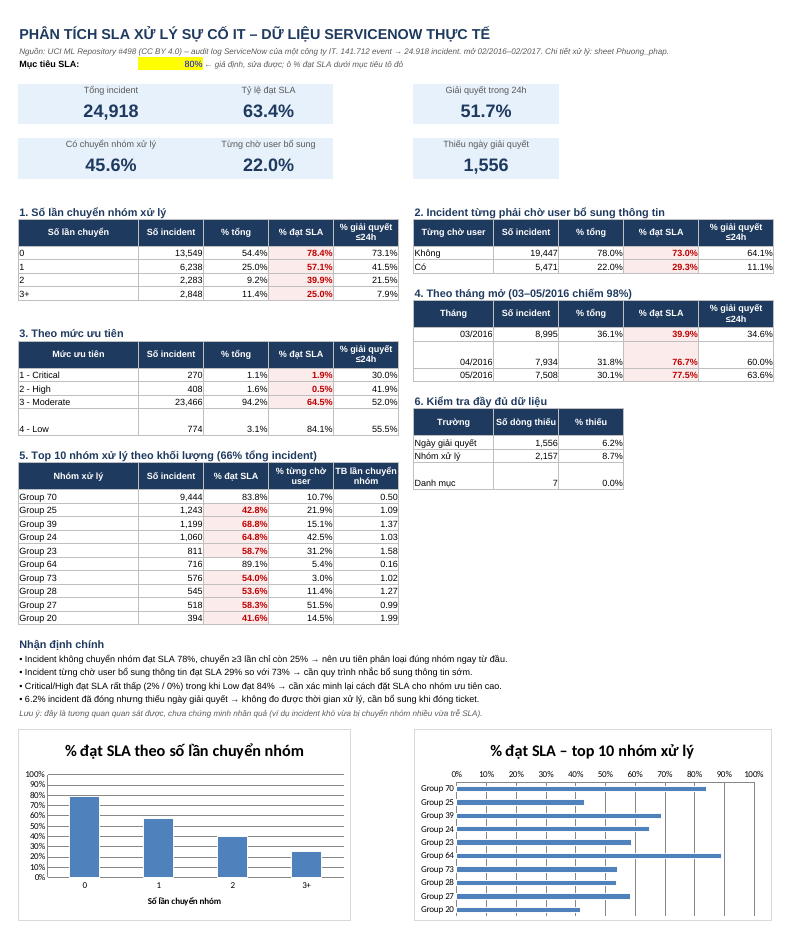

# Phân tích SLA xử lý sự cố IT trên dữ liệu ServiceNow thực tế

Dashboard Excel theo dõi tỷ lệ đạt SLA của 24.918 incident, dựng từ audit log ServiceNow công khai của một công ty IT. Mọi số liệu trên dashboard là công thức Excel: dán dữ liệu mới vào sheet `Data` là dashboard tự tính lại.



## Câu hỏi

Incident nào hay trễ SLA, và trễ ở khâu nào của quy trình xử lý?

## Kết quả chính

| Phát hiện | Số liệu |
|---|---|
| Tỷ lệ đạt SLA chung | 63,4% |
| Đạt SLA theo số lần chuyển nhóm xử lý: 0 / 1 / 2 / ≥3 | 78,4% / 57,1% / 39,9% / 25,0% |
| Incident từng phải chờ người dùng bổ sung thông tin / không phải chờ | 29,3% / 73,0% |
| Critical / High / Moderate / Low | 1,9% / 0,5% / 64,5% / 84,1% |
| Incident đã đóng nhưng thiếu ngày giải quyết | 1.556 (6,2%) |

**Ý nghĩa:**
- Chuyển nhóm xử lý và chờ thông tin từ người dùng là hai điểm nghẽn rõ nhất. Phân loại đúng nhóm ngay từ đầu và nhắc người dùng bổ sung thông tin sớm là hai hướng cải thiện đáng thử nhất.
- Critical/High đạt SLA thấp hơn hẳn Low. Điều này ngược với kỳ vọng, nhiều khả năng do cách hệ thống gốc đặt ngưỡng SLA (dataset không công bố ngưỡng). Đây là điểm cần xác minh, chưa phải kết luận.
- Đây là **tương quan, chưa phải nhân quả**: incident khó có thể vừa bị chuyển nhóm nhiều vừa trễ SLA. Muốn kết luận chắc hơn cần so sánh trong cùng danh mục và cùng mức ưu tiên.

## Dữ liệu

- Nguồn: [Incident management process enriched event log](https://archive.ics.uci.edu/dataset/498/incident+management+process+enriched+event+log), UCI Machine Learning Repository #498, giấy phép CC BY 4.0.
- 141.712 event, 36 cột. Mỗi lần ticket được cập nhật là một dòng, nên một incident có nhiều dòng.
- Tên người, nhóm, danh mục đã được ẩn danh sẵn trong dataset gốc (`Group 70`, `Category 55`...).
- 98% incident được mở trong 03–05/2016.

## Cách xử lý

1. **Gom event thành incident** (`src/prepare_data.py`): sắp theo `sys_mod_count`, lấy event cuối cùng làm trạng thái chốt của mỗi incident. Cờ "từng chờ user" = incident có ít nhất một event ở trạng thái `Awaiting User Info`. Giá trị `?` trong file gốc được coi là thiếu.
2. **Dựng dashboard** (`src/build_dashboard.py`): ghi bảng incident vào sheet `Data`, thêm 6 cột tự tính (tháng mở, thời gian giải quyết, nhóm số lần chuyển, cờ thiếu dữ liệu, cờ giải quyết ≤24h). Sheet `Dashboard` chỉ dùng COUNTIFS, SUMIFS, AVERAGEIF và Conditional Formatting.
3. **Kiểm tra:** recalc toàn bộ công thức bằng LibreOffice (0 lỗi trên 149.616 công thức) và đối chiếu các số chính với tính toán độc lập bằng pandas.

## Chạy lại

```bash
pip install -r requirements.txt
python src/prepare_data.py data/raw/incident_event_log.zip data/processed/incidents_clean.csv
python src/build_dashboard.py data/processed/incidents_clean.csv output/ServiceNow_Incident_SLA_Dashboard.xlsx
```

File raw không có trong repo: tải zip từ link UCI ở trên rồi đặt vào `data/raw/incident_event_log.zip`. File Excel do openpyxl tạo chưa có giá trị tính sẵn; mở bằng Excel là công thức tự tính.

## Cấu trúc

```
├── src/
│   ├── prepare_data.py        # event log -> 1 dòng / incident
│   └── build_dashboard.py     # bảng incident -> workbook Excel
├── data/
│   ├── raw/                   # zip gốc từ UCI (không commit)
│   └── processed/             # incidents_clean.csv (không commit)
├── output/
│   └── ServiceNow_Incident_SLA_Dashboard.xlsx   # Dashboard, Data, Phuong_phap
└── docs/
    └── dashboard_preview.png
```

## Hạn chế

- Không biết ngưỡng SLA cụ thể theo mức ưu tiên; `made_sla` do hệ thống gốc tính.
- Các tháng sau 05/2016 có quá ít incident để so sánh xu hướng.
- Tháng 03/2016 có tỷ lệ đạt SLA thấp bất thường (39,9% so với khoảng 77% của hai tháng sau), chưa xác định được nguyên nhân.
- Mục tiêu SLA 80% trên dashboard là giả định để tô màu cảnh báo, sửa được ở ô `Dashboard!C3`.
